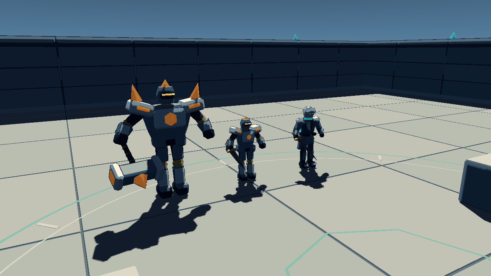

# Star Abyss / 星渊遗迹

Godot 4 第三人称 3D 动作 Roguelite 的 **P6 美术替换工程**。探索者、遗迹哨兵、晶核守卫与遗迹环境已使用本项目 Blender 资产，接入骨骼动画、独立武器和 Godot Toon 材质。保留主菜单、三房战斗、祝福、胜负与重开闭环。策划基线为 [GDD v1.0](docs/Star_Abyss_GDD_v1.0.md)，进度见 [TASKS.md](docs/TASKS.md)。美术观感与实体键鼠体验待人工验收，P7 打磨发布尚未授权。

## 启动

已验证环境：Windows、Godot **4.7 stable**、Forward+ / Vulkan、NVIDIA GTX 1660 SUPER。使用 GDScript，无第三方插件、无全局单例，无外部美术资源依赖。其他 Godot 4.x 版本尚未验证。

1. 在 Godot 项目管理器导入 `godot/project.godot`。
2. 打开工程，按 **F5** 进入主菜单，点击“开始本局”。先后完成遗迹前庭、星辉回廊和晶核封印。
3. 游戏开始捕获鼠标；Esc 暂停。暂停、胜利和失败界面均可重开或返回主菜单。关闭游戏窗口停止运行。

本机 PowerShell 启动命令（其他机器替换引擎路径）：

```powershell
& 'E:\share\Godot_v4.7\Godot_v4.7-stable_win64.exe' --editor --path 'D:\AiProject\StarAbyss\godot'
# 直接运行主场景
& 'E:\share\Godot_v4.7\Godot_v4.7-stable_win64.exe' --path 'D:\AiProject\StarAbyss\godot'
```

| 操作 | 按键 |
| --- | --- |
| 相对摄像机移动 | WASD |
| 旋转镜头 | 鼠标 |
| 跳跃 | Space |
| 地面闪避 | Shift |
| 三段普攻 / 连击缓冲 | 鼠标左键；在每段动作后段再次点击 |
| 星刃斩 | E |
| 暂停战斗并释放鼠标 | Esc / 窗口失焦 |
| 恢复控制 | Esc / 暂停菜单“继续探索” |
| 清空本局并重开 | 暂停或结算中的“重新开始” |

闪避方向取发起时的移动输入，无输入时朝面向方向；持续 **0.45 秒、约 4 米**，冷却 **1.2 秒，从开始时计算**。仅 **[0.10, 0.30) 秒** 无敌；闪避仍受重力、墙体和窗口外受伤影响。按住动作按键不会连续触发。

三段普攻伤害为 **12 / 16 / 24**，每段对同一目标最多命中一次，可同时击中多个目标。连击缓冲 0.18 秒，动作结束时消费仍有效的输入；中断 0.9 秒后从第一段开始。普通攻击仅在 Resource 配置的后段窗口允许闪避取消。E 技能为前方 5 米、70° 扇形，伤害 35，冷却 8 秒。空中不能发起普攻或技能。

角色有 100 HP，受伤后保护 0.5 秒、硬直 0.25 秒；技能动作承受伤害但不因硬直打断，死亡会立即终止攻击，暂停战斗并显示失败结算。

## 房间与祝福

- 默认主场景为 `godot/scenes/ui/main_menu.tscn`，开始后进入 `game_run.tscn`。遗迹前庭（2 哨兵）→ 星辉回廊（3 哨兵）→ 晶核封印（晶核守卫）；固定顺序切换，共用遗迹美术与原物理几何，出生点由 RoomDefinition 配置。Boss 采用适配其尺寸的独立预烘焙导航。
- 战斗中出口有实体屏障。全部敌人死亡后开门并暂停，第一次展示三张不同祝福，第二次仅展示尚未获得的两张；必须先选择，才能继续穿门。
- **烈焰之刃**：普攻倍率 ×1.20（正常三段取整后为 14/19/29），技能仍为 35。**疾风步伐**：之后发起的闪避冷却 0.9 秒，不追溯修改正在计时的冷却。**生命共鸣**：立即恢复 20 HP，之后每次玩家击杀普通敌人恢复 5 HP，均不超上限、不复活。
- 跨房间保留当前 HP、祝福及未结束的冷却。重新开始重新创建玩家、房间和祝福组件，清空本局数据。默认生成新随机种子；在 `game_run.tscn` Inspector 设置 `run_seed >= 0` 可复现候选/首招顺序，HUD 显示实际种子。
- HUD 左上显示 HP，右下显示技能/闪避冷却，顶部显示房间与目标。Esc 打开/关闭暂停；窗口失焦也会暂停。暂停和祝福选择期间冻结物理、战斗、冷却与本局用时，卡片点击不会触发额外普攻。
- 第三房 Boss 死亡后显示正式胜利：3 房、6 击杀、用时、两种祝福。玩家死亡则失败，显示实际清场数与本局统计；两者均暂停战斗并可重开或返回菜单。Boss 不提供第三次祝福，也不触发生命共鸣的普通敌人击杀回血。
- `room_run.tscn` 保留 P4 的第三房阶段终点，供独立验收使用；F5 的正式流程不经过该阶段终点。

## 晶核守卫

- 350 HP，移动速度 2.6 m/s。两招轮换，首招与招式间隔由本局种子驱动。
- **重锤横扫**：橙色扇形预警 0.8 秒，随后造成 20 伤害；范围 2.8 m、130°，生效 0.22 秒、恢复 0.65 秒。
- **晶能冲击**：以 Boss 为圆心、半径 4.2 m 的完整圆形预警 1.2 秒，随后造成 25 伤害；生效 0.2 秒、恢复 0.8 秒。
- 恢复结束后随机等待 1.6–2.4 秒再追近发起下一招；普通攻击不造成 Boss 硬直，但正常扣血、闪白、Hit Stop。两招均锁定方向/圆心，每实例最多命中一次；走出范围或正确闪避可避开攻击。
- 上方显示 Boss HP 与当前招式。Boss 或玩家死亡立即清理未完成攻击。未加入可选的 70% HP 加速机制。

## 保留的 P3 / P2 训练场

- 在 `godot/scenes/levels/sentinel_arena.tscn` 按 F6 可单独练习 P3 的 1v2。哨兵各有 45 HP，移速 3.2 m/s，10 m 内感知，1.8 m 内可发起攻击。
- 橙色扇形预警 **0.55 秒** 后，红色命中区生效 **0.18 秒**，造成 **10 伤害**，然后恢复 **0.55 秒**；冷却为 **1.3 秒**，从预警开始计算。预警方向锁定后不会追踪转向。
- 共享 FIFO 协调器只允许一名哨兵近身攻击，另一名在外围等待；攻击结束后留出 0.25 秒交接间隔。受击/死亡会立即取消判定并释放名额。
- 哨兵沿已烘焙导航网格绕障；目标不可达、失去感知或持续受阻时撤回，重试后可继续战斗。
- 该独立训练场顶部显示剩余哨兵和近身名额；击破后显示训练完成。Esc 释放鼠标后可重置。**只有保留的 P2/P3 训练场仍采用释放鼠标但不暂停的旧行为；P4 主场景会真正暂停。**
- P2 静止靶/伤害区保留在 `godot/scenes/levels/test_arena.tscn`；打开该场景按 F6，可单独练习技能和伤害规则。默认 P3 场景不包含这些训练设施。

## 结构与调参

```text
godot/
  scenes/{player,combat,enemies,boss,levels,ui}/
  scripts/{player,combat,ai,systems}/
  resources/default_player_movement.tres
  resources/combat/       三段攻击、技能、连击和冷却配置
  resources/enemies/      哨兵数值和攻击时序
  resources/navigation/   预烘焙导航网格
  resources/rooms/        固定房间与敌人出生点
  resources/blessings/    三种祝福元数据和效果参数
  resources/boss/         晶核守卫数值与两招时序
  tests/                  战斗规则与窗口集成测试
  assets/{models,animations,materials}/
blender/{characters,environments,exports}/
docs/                     架构、验收记录与场景预览
tools/                    验收脚本
```

`blender/characters/`、`blender/enemies/` 和 `blender/environments/` 保存七份可编辑 `.blend`，运行时仅加载 `godot/assets/models/` 中七份 GLB。三角色各18骨，含右手 WeaponSocket；共48个原地动画片段。美术方向、尺寸、重建命令和资产清单见 [ART_STYLE.md](docs/ART_STYLE.md)。无需 Blender 或 MCP 即可运行游戏。

- 在 Inspector 编辑 `godot/resources/default_player_movement.tres`：移动、跳跃、重力倍率、空中控制及闪避参数。统一重力在项目设置中为 18 m/s²。
- 编辑 `godot/resources/combat/default_player_combat.tres` 和其引用的攻击 Resource：伤害、动作长、命中/取消窗口、距离、扇形、缓冲和技能冷却。
- 在玩家场景 `CameraRig` 上设置灵敏度、俯仰范围和镜头距离；默认高 1.4 m、距离 4.5 m、俯仰 -12°，限制 -55° 至 +35°。`SpringArm3D` 使用球形扫掠防止墙角穿镜头。
- 两个训练场保留 `godot/scenes/levels/arena_geometry.tscn` 灰盒环境。正式房间使用其视觉继承场景 `scenes/art/ruins_arena.tscn`：隐藏旧网格，叠加遗迹 GLB，保留40×40米场地、围墙、平台、柱体的原碰撞及导航。
- 哨兵参数在 `godot/resources/enemies/default_sentinel.tres` 与 `sentinel_slash.tres`；攻击名额上限和交接间隔在场景的 `AttackCoordinator` 导出属性。
- `ActorPresentation` 读取 FSM/Combat/Brain 时钟采样骨骼动画；代码继续独占位移和伤害。攻击与闪避不使用第二套动画计时，Hit Stop 和暂停保持同步。武器跟随骨挂点，危险扇形继续由 AttackDefinition 绘制；旧网格与武器节点隐藏保留供路径兼容。受击闪白、伤害数字和占位音效沿用原组件。
- Toon 分色、阴影色与描边宽度在 `assets/materials/cel_surface.gdshader`、`cel_outline.gdshader` 调节；`ToonPalette` 转换 GLB 材质颜色，不修改共享源资产。近战仍是扇形/高度/视线判定，地面扇形展示有效距离；不是连续剑刃扫掠碰撞。

## 验证

在项目根目录使用 **PowerShell 7**：

```powershell
pwsh -File .\tools\verify.ps1
# 自定义引擎路径
pwsh -File .\tools\verify.ps1 -GodotPath 'C:\Tools\Godot\Godot_console.exe'
# 没有图形桌面时，检查引用、导入、主场景与战斗规则
pwsh -File .\tools\verify.ps1 -HeadlessOnly
```

完整验收覆盖 **544 项不同断言**：原 P1–P5 的447项与新增97项美术检查。美术 headless 执行其中96项，图形模式复验这96项并增加真实帧检查，不重复计数。检查覆盖蒙皮/骨骼、静止根骨、实际武器几何朝向、动作时长/轨迹、Hit Stop/暂停/死亡同步及环境碰撞保留。完整闭环图形测试仍从菜单实际点击开始，连续三局真实战斗、选卡、走门和Boss致胜，另验重开/菜单/失败；不修改实战数值。

修改共享场地实体几何后，需重烘焙导航并重新验收：

```powershell
& 'E:\share\Godot_v4.7\Godot_v4.7-stable_win64_console.exe' --headless --path 'D:\AiProject\StarAbyss\godot' --script '../tools/bake_navigation.gd'
# Boss 使用更大的导航半径，几何修改后也需重烘焙
& 'E:\share\Godot_v4.7\Godot_v4.7-stable_win64_console.exe' --headless --path 'D:\AiProject\StarAbyss\godot' --script '../tools/bake_navigation.gd' -- --guardian
pwsh -File .\tools\verify.ps1
```

烘焙仅解析 World 静态碰撞体，两份网格当前各 62 个多边形；哨兵半径/高度为 0.5/1.75，Boss 为 0.75/2.75。修改体素高度时还需检查 NavigationAgent 的 `path_height_offset`（当前 0.5 m），保持路径与角色脚底一致。运行游戏无需再烘焙。

完整验收会打开普通主场景，再在窗口中注入输入和执行真实物理步进，生成 P2/P3/P4 预览。集成测试关闭持续绘制，并对截图显式调用 Forward+ 绘制；不代表性能基准。P4 检查 1280×720 与 1920×1080。运行期间请不要操作窗口或移动鼠标。日志在 `.local/validation/`；任一脚本、资源或引擎错误均导致失败。headless 无法代替窗口输入与渲染验收。

测试进程单独将 APPDATA 定向至项目内 `.local/appdata/`，避免改写已有 Godot 编辑器设置；正常手动启动不受影响。受限沙箱可能禁止读取 Windows 证书库，应在允许系统访问的环境执行验收。

人工步骤和验证边界见 [docs/TESTING.md](docs/TESTING.md)，技术架构见 [docs/ARCHITECTURE.md](docs/ARCHITECTURE.md)，环境记录见 [docs/ENVIRONMENT.md](docs/ENVIRONMENT.md)。



[动作生效姿态](docs/p6_attack_preview.png) · [Boss 圆形预警](docs/guardian_shockwave_preview.png) · [胜利结算](docs/victory_preview.png) · [失败结算](docs/failure_preview.png) · [主菜单](docs/main_menu_preview.png)
